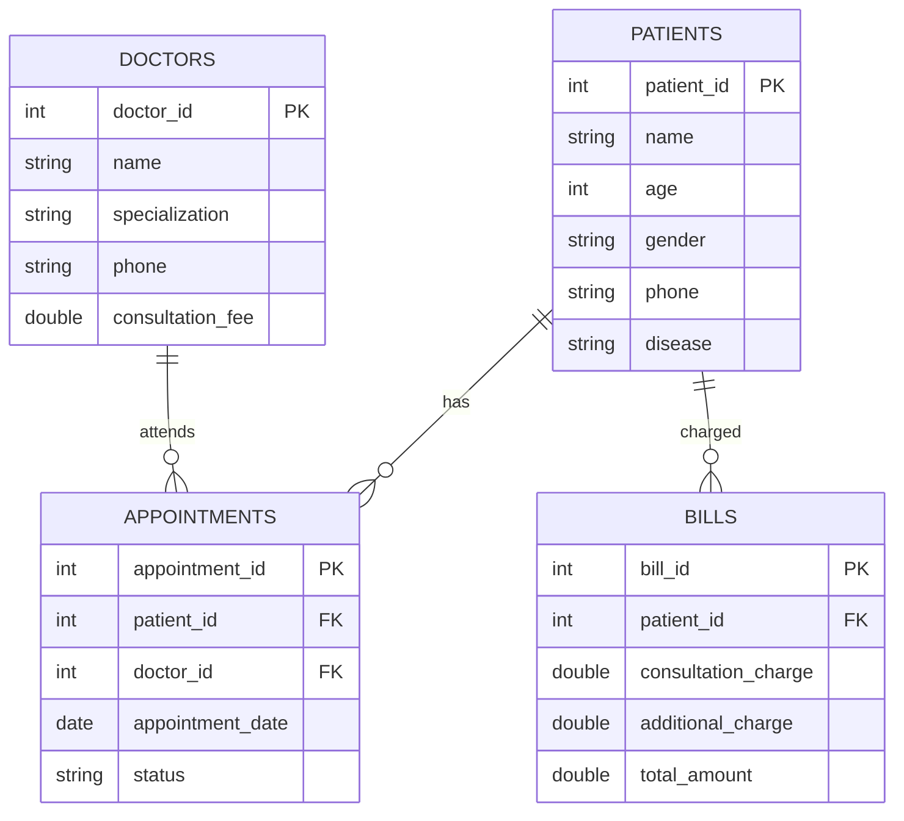

# MEDICARE – Simple Hospital Management System

A beginner-friendly, menu-driven **Command-Line Interface (CLI)** Hospital Management System built using **Java (JDK 17+)**, **MySQL 8.0**, and **JDBC**.

Designed specifically for academic evaluation, BCA / B.Tech practical examinations, and viva voce demonstrations, this project demonstrates core **Object-Oriented Programming (OOP)** principles and robust relational database connectivity.

---

## 1. Project Overview

**MEDICARE** automates daily operational workflows of a hospital:
- **Patient Registration & Management**: Add, view, search, update, and delete patient records.
- **Doctor Management**: Register doctors with specializations, contact details, and consultation fees.
- **Appointment Scheduling**: Book appointments linking patients with doctors, view appointments, and cancel existing bookings.
- **Billing & Invoicing**: Calculate consultation and additional charges (tests, medicines, rooms) and print clean terminal receipts.

---

## 2. Technology Stack

| Component | Technology / Library |
| :--- | :--- |
| **Language** | Java 17+ (SE) |
| **Database** | MySQL 8.0+ |
| **Connectivity** | JDBC (Java Database Connectivity) |
| **Driver** | MySQL Connector/J (`lib/mysql-connector-j-9.4.0.jar`) |
| **User Input** | `java.util.Scanner` |
| **Data Collections**| `java.util.ArrayList` (for temporary in-memory records) |
| **Architecture** | CLI Menu-Driven, Layered Object-Oriented Design |

> **Note:** As specified, this project does not use JavaFX, Swing, Spring Boot, or any heavy framework. It uses pure Core Java and JDBC.

---

## 3. Object-Oriented Programming (OOP) Demonstration

| OOP Concept | Implementation in MEDICARE | Java Source Files |
| :--- | :--- | :--- |
| **Abstraction** | `Person` is defined as an `abstract class` containing an abstract method `public abstract void displayDetails();`. It cannot be instantiated directly and serves as a blueprint for human entities. | `Person.java` |
| **Inheritance** | `Patient` and `Doctor` both extend the parent `Person` class, inheriting common properties (`id`, `name`, `phone`) and invoking `super(id, name, phone)`. | `Patient.java`, `Doctor.java`, `Person.java` |
| **Polymorphism** | **Method Overriding & Dynamic Dispatch**: `Patient` and `Doctor` provide their own unique implementation of `displayDetails()`. In memory, iterating over an `ArrayList<Person>` invokes the appropriate subclass version dynamically. | `Patient.java`, `Doctor.java`, `OopVerificationTest.java` |
| **Encapsulation** | All entity fields are declared `private`. Public getters and setters provide controlled access with input sanitization and encapsulation of business calculation logic (`Bill.calculateTotal()`). | `Person.java`, `Patient.java`, `Doctor.java`, `Appointment.java`, `Bill.java` |
| **Constructors** | Parameterized and default constructors are implemented across all model classes to ensure valid object states upon instantiation. | All model classes |

---

## 4. Project Structure

```text
MEDICARE/
│
├── Main.java                     # Application entry point with CLI main menu
├── DatabaseConnection.java       # Centralized JDBC connection manager (db.properties)
├── Person.java                   # Abstract base class (Abstraction & Inheritance)
├── Patient.java                  # Patient entity extending Person (Polymorphism)
├── Doctor.java                   # Doctor entity extending Person (Polymorphism)
├── Appointment.java              # Appointment model with status and foreign keys
├── Bill.java                     # Billing model with calculation and invoice printing
├── PatientManagement.java        # CRUD operations for patients
├── DoctorManagement.java         # CRUD operations for doctors
├── AppointmentManagement.java    # Booking, viewing, searching, and cancelling appointments
├── BillingManagement.java        # Bill generation, calculation, and invoice viewing
│
├── OopVerificationTest.java      # Standalone verification class for Viva / Academic demo
├── schema.sql                    # MySQL schema creation script with sample data
├── db.properties                 # Database configuration file (host, user, password)
├── compile.sh                    # Linux/macOS compilation script
├── run.sh                        # Linux/macOS run script
├── run.bat                       # Windows build and run batch script
├── README.md                     # Complete project documentation
└── lib/
    └── mysql-connector-j-9.4.0.jar # MySQL JDBC Driver
```

---

## 5. MySQL Database Design

The system connects to database `medicare_db` containing four relational tables:



### Table Definitions:

1. **`patients`**
   - `patient_id` (INT, PRIMARY KEY, AUTO_INCREMENT)
   - `name` (VARCHAR(100), NOT NULL)
   - `age` (INT, NOT NULL)
   - `gender` (VARCHAR(10), NOT NULL)
   - `phone` (VARCHAR(15), NOT NULL)
   - `disease` (VARCHAR(100), NOT NULL)

2. **`doctors`**
   - `doctor_id` (INT, PRIMARY KEY, AUTO_INCREMENT)
   - `name` (VARCHAR(100), NOT NULL)
   - `specialization` (VARCHAR(100), NOT NULL)
   - `phone` (VARCHAR(15), NOT NULL)
   - `consultation_fee` (DOUBLE, NOT NULL)

3. **`appointments`**
   - `appointment_id` (INT, PRIMARY KEY, AUTO_INCREMENT)
   - `patient_id` (INT, FOREIGN KEY referencing `patients(patient_id)`)
   - `doctor_id` (INT, FOREIGN KEY referencing `doctors(doctor_id)`)
   - `appointment_date` (DATE, NOT NULL)
   - `status` (VARCHAR(20), DEFAULT 'Scheduled')

4. **`bills`**
   - `bill_id` (INT, PRIMARY KEY, AUTO_INCREMENT)
   - `patient_id` (INT, FOREIGN KEY referencing `patients(patient_id)`)
   - `consultation_charge` (DOUBLE, NOT NULL)
   - `additional_charge` (DOUBLE, NOT NULL)
   - `total_amount` (DOUBLE, NOT NULL)

---

## 6. Setup and Execution Guide

### Prerequisites
1. **Java JDK 17 or higher** installed. Check with:
   ```bash
   java -version
   javac -version
   ```
2. **MySQL Server 8.0+** installed and running on port `3306`. Check with:
   ```bash
   mysql --version
   ```

---

### Step 1: Initialize Database & Tables
Log in to MySQL and execute the `schema.sql` file:
```bash
mysql -u root -p < schema.sql
```
*Or open MySQL Workbench / phpMyAdmin / MySQL CLI and run the contents of `schema.sql`.*

This creates the `medicare_db` database, all four tables, foreign key constraints, and inserts initial sample records.

---

### Step 2: Configure Database Credentials
Open `db.properties` in any text editor and update your MySQL username and password:
```properties
db.url=jdbc:mysql://localhost:3306/medicare_db?useSSL=false&allowPublicKeyRetrieval=true&serverTimezone=UTC
db.user=root
db.password=your_mysql_password
```
*(If your MySQL `root` user has no password, leave `db.password=` empty).*

---

### Step 3: Compile and Run the Project

#### On macOS / Linux:
```bash
# 1. Make scripts executable (one-time)
chmod +x compile.sh run.sh

# 2. Compile all source files
./compile.sh

# 3. Run the Medicare application
./run.sh
```

#### On Windows:
Double-click `run.bat` or run in Command Prompt:
```cmd
run.bat
```

#### Manual Compilation & Execution:
```bash
# Compile with MySQL Connector in classpath
javac -cp ".:lib/*" *.java

# Run Main
java -cp ".:lib/*" Main
```
*(On Windows cmd, replace `:` with `;`: `javac -cp ".;lib/*" *.java` and `java -cp ".;lib/*" Main`)*

---

## 7. Standalone OOP Verification & Viva Demo

To demonstrate OOP concepts (Inheritance, Polymorphism, Abstraction, Encapsulation) independently without connecting to MySQL, run:

```bash
java -cp ".:lib/*" OopVerificationTest
```

This executes an automated test proving:
- `Person` cannot be instantiated directly (abstract class).
- `Patient` and `Doctor` inherit fields and invoke `super()`.
- Dynamic method dispatch works when iterating over an `ArrayList<Person>`.
- Billing arithmetic and private encapsulation functions correctly.

---

## 8. CLI Interface & Sample Execution

### Main Menu
```text
=========================================
          MEDICARE HOSPITAL              
           MANAGEMENT SYSTEM             
=========================================
[i] Checking database connection... [✓] Connected to MySQL Database (medicare_db)

=========================================
          MEDICARE HOSPITAL              
           MANAGEMENT SYSTEM             
=========================================
1. Patient Management
2. Doctor Management
3. Appointment Management
4. Billing Management
5. Exit
Enter your choice: 
```

### Patient Management
```text
=========================================
           PATIENT MANAGEMENT            
=========================================
1. Add Patient
2. View All Patients
3. Search Patient
4. Update Patient
5. Delete Patient
6. Back to Main Menu
Enter your choice: 2

--- All Registered Patients ---
+------+----------------------+------+----------+--------------+----------------------+
| ID   | Name                 | Age  | Gender   | Phone        | Disease              |
+------+----------------------+------+----------+--------------+----------------------+
| 1    | Rahul Sharma         | 32   | Male     | 9876543210   | Viral Fever          |
| 2    | Priya Patel          | 28   | Female   | 9812345678   | Migraine             |
| 3    | Amit Verma           | 45   | Male     | 9845612340   | Hypertension         |
+------+----------------------+------+----------+--------------+----------------------+
Total Patients: 3
```

### Doctor Management
```text
=========================================
            DOCTOR MANAGEMENT            
=========================================
1. Add Doctor
2. View All Doctors
3. Search Doctor
4. Delete Doctor
5. Back to Main Menu
Enter your choice: 2

--- All Registered Doctors ---
+------+------------------------+------------------------+--------------+---------------+
| ID   | Name                   | Specialization         | Phone        | Consult Fee   |
+------+------------------------+------------------------+--------------+---------------+
| 1    | Dr. Ananya Roy         | General Physician      | 9988776655   | Rs. 500.00    |
| 2    | Dr. Vikram Malhotra    | Cardiologist           | 9977665544   | Rs. 800.00    |
| 3    | Dr. Sneha Nair         | Neurologist            | 9966554433   | Rs. 750.00    |
+------+------------------------+------------------------+--------------+---------------+
Total Doctors: 3
```

### Appointment Booking
```text
=========================================
         APPOINTMENT MANAGEMENT          
=========================================
1. Book Appointment
2. View All Appointments
3. Search Appointment
4. Cancel Appointment
5. Back to Main Menu
Enter your choice: 1

--- Book New Appointment ---
Enter Patient ID: 1
-> Selected Patient: Rahul Sharma (Age: 32)
Enter Doctor ID: 2
-> Selected Doctor: Dr. Vikram Malhotra (Cardiologist) | Fee: Rs. 800.0
Enter Appointment Date (YYYY-MM-DD) [Press ENTER for Today]: 2026-11-20

==================================================
         APPOINTMENT BOOKED SUCCESSFULLY!         
==================================================
 Appointment ID : #3
 Patient        : Rahul Sharma (ID: 1)
 Doctor         : Dr. Vikram Malhotra (Cardiologist)
 Date           : 2026-11-20
 Status         : Scheduled
 Consultation   : Rs. 800.0
==================================================
```

### Terminal Bill & Invoice
```text
==================================================
            MEDICARE HOSPITAL - INVOICE           
==================================================
 Bill ID             : #2
 Patient ID          : #1
 Patient Name        : Rahul Sharma
--------------------------------------------------
 Consultation Charge : Rs.     800.00
 Additional Charges  : Rs.     350.00
--------------------------------------------------
 TOTAL AMOUNT DUE    : Rs.    1150.00
==================================================
```

---

## 9. Viva Voce & Academic Q&A (For BCA Exam)

**Q1: What is the purpose of an abstract class in this project?**
> *Answer:* `Person` is an abstract class because a "Person" by itself is an incomplete concept in a hospital—every person is either a `Patient` or a `Doctor`. It declares common attributes (`id`, `name`, `phone`) and an abstract method `displayDetails()`, forcing subclasses to provide their own display implementation.

**Q2: How is Polymorphism demonstrated?**
> *Answer:* Polymorphism is demonstrated through method overriding. Both `Patient` and `Doctor` override the `displayDetails()` method declared in `Person`. When we store `Patient` and `Doctor` objects in an `ArrayList<Person>` and iterate through them calling `person.displayDetails()`, Java determines at runtime which version to execute based on the actual object type (Dynamic Method Dispatch).

**Q3: Why use `PreparedStatement` instead of `Statement`?**
> *Answer:*
> 1. **Security**: `PreparedStatement` automatically sanitizes inputs and parameterizes queries (`?`), preventing **SQL Injection attacks**.
> 2. **Performance**: Pre-compiled queries are cached by the database server for faster execution when executed repeatedly.
> 3. **Data Type Handling**: It handles dates, strings with special characters, and numeric conversions cleanly via `setString()`, `setInt()`, `setDate()`.

**Q4: What is `try-with-resources` and where is it used?**
> *Answer:* In `DatabaseConnection`, `PatientManagement`, and other classes, database resources (`Connection`, `PreparedStatement`, `ResultSet`) implement `AutoCloseable`. The `try-with-resources` statement ensures that every database resource is automatically closed when the try block exits, preventing connection leaks.

**Q5: How does the application handle foreign key constraints?**
> *Answer:* `appointments` and `bills` have foreign keys referencing `patients(patient_id)` and `doctors(doctor_id)`. Before booking an appointment or generating a bill, the Java program queries the database to verify that the patient and doctor IDs exist, preventing runtime constraint violation errors.

---

## 10. License & Submission
Developed for academic assessment and learning purposes. Suitable for BCA, B.Sc Computer Science, and B.Tech coursework.
